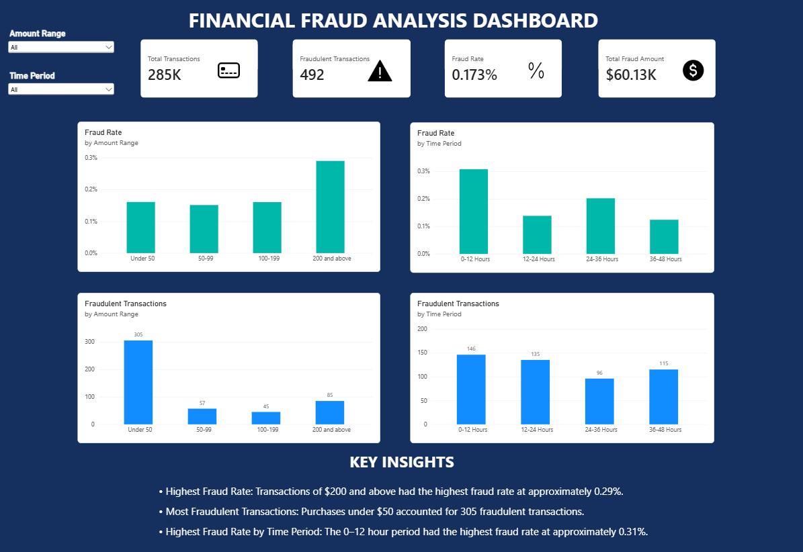

# Financial Fraud Analysis Dashboard

## About the Project

For this project, I analyzed a dataset of over 284,000 credit card transactions to look for patterns in fraudulent activity.

I used SQL to explore the data and Power BI to build an interactive dashboard that shows how fraud changes based on transaction amounts and time periods.

## Tools Used

- **SQL (SQLite)** - Analyzed the data and looked for fraud patterns.
- **Power BI** - Created the interactive dashboard.
- **Power Query** - Organized and prepared the data.
- **DAX** - Calculated fraud rates, transaction counts, and other metrics.
- **GitHub** - Stored and shared the project.

## Dashboard Preview

## What I Found

- **284,807 total transactions**, with only **492 marked as fraudulent**.
- The overall fraud rate was **0.173%**.
- Transactions of **200 and above** had the highest fraud rate at around **0.29%**.
- Transactions under **50** had the most fraud cases, with **305 fraudulent transactions**.
- The first **12-hour period** had the highest fraud rate at around **0.31%**.

## Dashboard Features

The dashboard includes:

- Total transactions, fraud cases, fraud rate, and total fraud amount.
- Charts comparing fraud by transaction amount and time period.
- Interactive filters that let users explore different parts of the data.

## What I Learned

This project gave me more experience using SQL to work with large datasets and Power BI to turn data into something easier to understand.

I also learned that looking at fraud rates and the number of fraud cases can tell two different stories.

## Project Files

- `Financial_Fraud_Dashboard.pbix` - Power BI dashboard
- `fraud_analysis.sql` - SQL analysis
- `dashboard.png` - Dashboard screenshot
Dashboard Preview
Dashboard screenshot coming soon.
